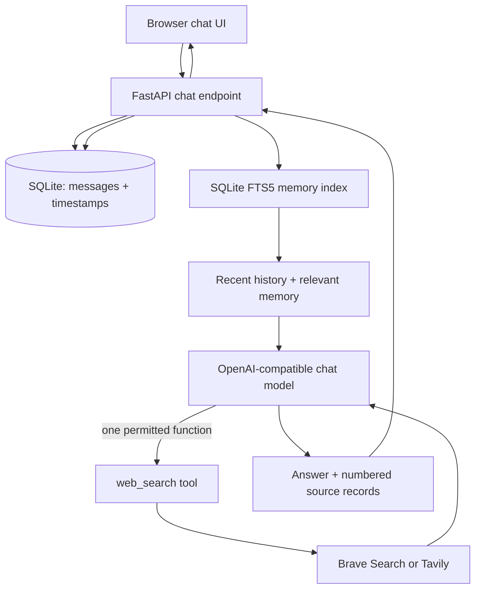

# Chronicle — Design Notes

## Goal

Build a fast, useful chat agent with exactly one external capability: web search. The agent must also remember what a user asked and when, so it can answer follow-up and recall questions without pretending to have a human-like memory.

## Product principles

1. **One tool, clearly bounded.** The model can call only `web_search`. It cannot browse arbitrary URLs, execute code, send messages, or mutate external systems.
2. **Evidence before confidence.** Current or niche facts trigger search. Search results are treated as untrusted evidence; answers distinguish supported facts from inference and include source links.
3. **Memory is timestamped data.** Every user and assistant message is stored with a UTC timestamp. Search queries and completion times are stored separately, so the agent can recall both the question and the research event.
4. **Fast by default.** The model receives a short recent-history window and a small set of relevant memory matches, not the entire database. Search returns at most five compact results. Tool calls are capped at two per answer.
5. **User-controlled deployment.** Model and search providers are configured through environment variables. No API key is committed to the repository.

## Architecture

### Request lifecycle

1. The browser creates or resumes a random session identifier and sends the user message.
2. The API records the message using an ISO-8601 UTC timestamp.
3. FTS5 retrieves a small set of earlier messages relevant to the new question. The API also loads the latest conversation turns.
4. The model receives the timestamped memory context and the single `web_search` function schema.
5. If needed, the model calls `web_search`. The API records the query, start time, completion time, and normalized result metadata.
6. The model writes an answer grounded in the returned records. The API stores the answer (with its numbered source records in `messages.sources_json`) and returns it with source cards; reloads render the same cards from the history endpoint.

## The one-tool contract

`web_search(query, freshness)` is the only external tool exposed to the model. Its implementation can use Brave Search or Tavily, selected by configuration, but the agent sees one stable function and one normalized result schema:

- `title`
- `url`
- `snippet`
- `published`

The agent caps each search to five results and caps a response to two tool-call rounds. Search-provider instructions and page text are never treated as agent instructions.

## Memory model

SQLite stores two durable records:

- `messages`: role, content, session identifier, `created_at`, and a `sources_json` column holding the numbered source records shown with the assistant's answer. Existing databases are migrated in place (`ALTER TABLE ... ADD COLUMN`) on startup.
- `tool_events`: tool name, query, `started_at`, `completed_at`, and normalized results.

Deleting a session removes the `sessions` row and cascades to `messages` and `tool_events`; the FTS5 virtual table has no foreign-key cascade, so `messages_fts` rows are deleted explicitly by `session_id`. `GET /api/export` returns a portable JSON document (`format: chronicle-export/1`) containing the session row, all messages with sources, and all tool events. `DELETE /api/session` performs the deletion. Read-only endpoints (`/api/history`, `/api/memory/search`) never create a session as a side effect; unknown sessions return empty results.

FTS5 indexes message text. At each turn, the memory retriever extracts query terms and searches only the active session. A bounded number of matches is provided to the model with timestamps. The `/api/memory/search` endpoint makes the same retrieval behavior inspectable.

Timestamps are stored in UTC to avoid ambiguity. The UI renders them in the browser's local timezone. Session IDs isolate conversation histories; they are not authentication credentials. A production multi-user deployment should add authentication, encryption at rest, retention controls, and per-user authorization.

## Latency choices

- Small context window (`MAX_HISTORY_MESSAGES`, default 12 messages).
- FTS5 retrieval instead of sending all prior messages to the model.
- Search snippets are capped and only five results are returned per call.
- A two-round tool-call ceiling prevents unbounded agent loops.
- Model temperature is low for more consistent factual responses.

A future streaming transport (SSE) could display the first tokens while the model is composing, but the current API intentionally keeps the code path simple and testable.

## Correctness and failure behavior

- Missing model credentials return a clear `503` configuration error. The `502` returned for model-request failures logs the underlying exception server-side and returns a generic message, so provider internals do not leak to clients.
- Search-provider errors are passed back to the model as truncated tool errors, rather than silently fabricating results.
- Only HTTP(S) source URLs are returned to the browser; the UI additionally drops source cards whose URLs fail to parse or are not `http(s)`.
- Responses carry restrictive security headers (strict CSP, `X-Frame-Options: DENY`, `nosniff`, `Referrer-Policy`). `/api/chat` is rate limited per client IP (`RATE_LIMIT_PER_MINUTE`, sliding 60-second window, `429` + `Retry-After` when exceeded); the limiter is per-process and intentionally simple.
- `/health` performs a `SELECT 1` probe against SQLite and reports `503` with `database: error` when degraded.
- Floating query inputs (search `freshness`, `MAX_HISTORY_MESSAGES`) are validated/clamped rather than trusted.
- The assistant is instructed to cite supplied source records, distinguish inference, and say when evidence is insufficient.
- Tests cover timestamp preservation, session isolation, chronological history retrieval, the full tool-call loop with a mocked model, source persistence, export, deletion, rate limiting, and read-only history behavior.

## Trade-offs and limitations

- Search snippets are not a substitute for reading full primary-source documents. The current single-tool challenge scope intentionally avoids a second fetch/open-page tool.
- Memory retrieval is lexical, not embedding-based. This keeps latency and infrastructure requirements low; semantic retrieval can be added without changing the single external-tool contract.
- SQLite is ideal for a self-hosted demo and a single-node deployment, but a multi-instance production deployment should move persistence to PostgreSQL and add authenticated access.
- The application records conversation content. Operators must disclose retention behavior and provide deletion/export controls before using it with sensitive data.
- Search freshness metadata depends on the provider and is not guaranteed for every result.

## Evaluation checklist

- [ ] Current-fact question invokes web search and returns source cards.
- [ ] Stable general-knowledge question can be answered without unnecessary search.
- [ ] Follow-up question uses recent context.
- [ ] Recall question returns the original message and UTC timestamp.
- [ ] Same phrase in another session is not exposed in this session.
- [ ] Missing model or search credentials produce explicit errors.
- [ ] Search results cannot add tools or override system behavior.
